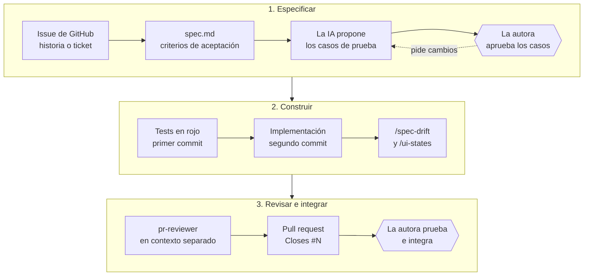

> Registro del uso de IA en el desarrollo de **Platita**. Sigue la plantilla del curso: secciones 1 a 7, con un máximo de tres prompts por sección. Cada prompt se transcribe **textual**, tal como se escribió, sin corregir la redacción. Se eligieron los que cambiaron una decisión, incluidos los que rechazaron o corrigieron una propuesta de la IA, que son los que mejor muestran dónde estuvo el criterio humano.
>
> El registro completo, con todos los prompts, los ajustes humanos y los patrones de cada fase, está en [`docs/registro-ia.md`](docs/registro-ia.md). La conversación de la reestructuración de la documentación está entera en [`docs/conversacion-reestructuracion-docs.md`](docs/conversacion-reestructuracion-docs.md).

## Herramientas y modelos por fase

| Fase | Herramienta | Modelo | Para qué |
|---|---|---|---|
| Ideación y documentación de la entrega 1 | Claude (claude.ai) | Claude Opus 4.1 | Iterar la idea sin generar documentación, y después redactar arquitectura, modelo de datos, historias y tickets |
| Análisis de los repositorios de referencia | Claude Code | Claude Sonnet 4.5 | Auditar la plantilla y los dos proyectos de ejemplo del curso, con su historial git |
| Reestructuración de la documentación | Claude Code | Claude Opus 5, contexto 1M | Partir el readme en `docs/`, extraer las reglas de dominio, escribir `AGENTS.md`, los primeros ADR y los verificadores |
| Diseño y validación de la especificación | Claude Code | Claude Opus 5.5, contexto 1M | Sesiones de solo lectura con un rol experto —arquitectura, datos, amenazas, operación, casos de uso, módulos del curso—, decisiones de la autora y su registro en `docs/` y en un ADR |
| Código de la entrega 2 y de la final | Claude Code | Claude Opus 5.5, contexto 1M | Tests primero: la IA propone los casos, la autora los aprueba, los tests fallan y recién entonces se implementa |
| Revisión | Claude Code: agente `pr-reviewer` y commands del repositorio | Claude Opus 5.5, en un contexto separado | Revisar cada pull request sin conocer la conversación que lo escribió, y comparar la especificación con el código |
| Elección del modelo del producto | [`scripts/llm_eval/`](scripts/llm_eval/run_eval.py) | GPT-5.4 mini, GPT-5.4 nano y Claude Haiku 5.5 | 30 casos con resultados esperados aprobados por la autora ([ADR 0025](docs/adr/0025-gpt-5-4-mini-como-modelo-de-lenguaje.md)) |
| Interpretación de los mensajes, dentro del producto | API de OpenAI | GPT-5.4 mini | Clasificar cada mensaje y devolver los campos de un gasto o un ingreso, con el prompt `classification-5` |
| Despliegue | *(pendiente, entrega final)* | | |

## Metodología

Todo el código del backend se escribió con un flujo fijo, con dos puntos donde decide una persona. La IA no
escribe un test sin casos aprobados, y nunca integra.

El dibujo muestra la vuelta de los casos. La otra, sin dibujar para que el diagrama se lea: si
la autora pide cambios al probar, se vuelve a construir en la misma rama. Antes de cada
entrega, `/spec-drift` sobre todo el proyecto y `/security-audit`. El avance se
sigue en el [tablero de la entrega final](https://github.com/users/verozacarias-prog/projects/1).

Las sesiones de diseño siguieron otro patrón, que se repite en las secciones 2 a 6: un prompt
largo que fija un rol experto y un criterio de prioridades, en **modo de solo lectura**; un
informe con evidencia citada por archivo; las decisiones de la autora, de a una; y recién ahí la
escritura en `docs/` y en un ADR. Cuando un prompt venía del material del curso, primero se
contrastó contra la especificación.

## Agentes, commands, skills y verificadores

Todo está versionado en el repositorio. El detalle está en el
[flujo de trabajo con IA](docs/flujo-de-trabajo-con-ia.md).

| Qué | Tipo | Para qué |
|---|---|---|
| [`AGENTS.md`](AGENTS.md) | Contrato | Lo que cualquier asistente tiene que respetar: regla hexagonal, invariantes, convenciones y método. `CLAUDE.md` es un enlace a este archivo |
| `pr-reviewer` | Agente | Revisa un pull request en un contexto separado, sin conocer la conversación que lo escribió. Su informe se pega en el pull request |
| `/spec-drift` | Command | Compara la especificación con el código y reporta las diferencias sin resolverlas. Al cerrar cada corte y antes de cada entrega |
| `/security-audit` | Command | Audita el backend contra el OWASP Top 10 web y el de aplicaciones LLM, de a un hallazgo. Antes de cada entrega |
| `/ui-states` | Command | Verifica que una pantalla implementa y testea sus cuatro estados |
| `domain-rules` | Skill | Se activa solo cuando un trabajo toca movimientos, cuentas, presupuestos o categorías, y dice qué reglas aplican |
| Tres verificadores y un hook de pre-commit | Scripts | Enlaces y duplicación de la documentación, regla hexagonal, y la referencia de la API contra `docs/04-api.md`. Rompen el commit |

---

## Índice

1. [Descripción general del producto](#1-descripción-general-del-producto)
2. [Arquitectura del sistema](#2-arquitectura-del-sistema)
3. [Modelo de datos](#3-modelo-de-datos)
4. [Especificación de la API](#4-especificación-de-la-api)
5. [Historias de usuario](#5-historias-de-usuario)
6. [Tickets de trabajo](#6-tickets-de-trabajo)
7. [Pull requests](#7-pull-requests)

---

## 1. Descripción general del producto

**Prompt 1** — *Claude (claude.ai) · ideación inicial*

> "Sí, quiero eh, contarte la idea del proyecto y ir iterándola. Eh, en la primera entrega de, de este proyecto final es solo documentación, o sea, desarrollar la idea igual después te voy a pasar bien el documento pero es desarrollar la idea y presentar toda la documentación ahora solo quiero que iteremos la idea sin generar ningún tipo de documentación Eh, ellos especifican que tiene que ser todo desarrollado de punta a punta con IA"

*Qué se decidió:* no generar documentación todavía fue deliberado, para que el asistente no
saltara al entregable antes de que la idea estuviera decidida. De dos dominios, financiero y
hábitos, ganó el financiero por ser una necesidad propia: varias cuentas, dos monedas y un
presupuesto familiar resueltos a mano en planillas. La conversación que abrió produjo las
secciones 1 a 6 de la entrega 1.

**Prompt 2** — *Claude Code · auditoría de los repositorios de referencia*

> "no no para, ya clone los repo, porque tambien me sirve tener el codigo local, quiero que hagas especial enfasis en agentes, skills y todo lo que hayan hecho en esos repos para uso de ia, dame el prompt"

*Qué se decidió:* con los repos en local, Claude Code pudo leer el historial git completo y no
solo los archivos. Encontró que ninguno de los dos ejemplos versionó configuración de IA, y que
el error más común era que la documentación no coincidiera con el código: arquitectura AWS
documentada sobre mocks JSON, 85% de cobertura declarada con 11 tests. De ahí salieron dos
reglas del proyecto: versionar las reglas para la IA antes de codear, y no escribir ninguna cifra
sin verificarla.

**Prompt 3** — *Claude (claude.ai) · alinear el alcance con lo que pide el curso*

> "bueno, volve a leer Proyecto Final Master, el documento de contexto, para alinear lo que tenemos hasta ahora con lo ellos piden recomiendan"

*Qué se decidió:* la sección 1.2 listaba 14 funcionalidades contra 3 historias de usuario, y el
curso pide entre 3 y 5 must-have completas. Las funcionalidades se clasificaron en must, should
y could-have, con lo could-have declarado como diseñado y no implementado, y las historias
subieron a cinco para cubrir lo must-have sin historia.

---

## 2. Arquitectura del Sistema

### 2.1. Diagrama de arquitectura

**Prompt 1** — *Claude (claude.ai) · el patrón arquitectónico, nombrado*

> "-todo el desarrollo va a estar en ingles, por lo tanto nombres en base de datos etc tambien
> -no mencionas que se va a usar arquitectura hexagonal"

*Qué se decidió:* la documentación decía "por capas" sin comprometerse. Pasó a declarar
arquitectura hexagonal, con el dominio detrás de puertos y los adaptadores separados en el
diagrama y en las carpetas, justificada por las integraciones reemplazables: WhatsApp, el LLM,
la base vectorial y las cotizaciones. El código, las tablas y los endpoints van en inglés.

**Prompt 2** — *Claude (claude.ai) · diagramas C4, verificados antes de darlos por buenos*

> "bueno, ahora en el documento de contexto de proyecto final de ai4devs, indican algunas herramientas para generar mejores graficos y documentaciones, si es necesario releelo centrandote en eso, y apliquemos eso al nuestro documento"

*Qué se decidió:* la arquitectura pasó a los tres niveles de C4 en Mermaid. La IA propuso la
sintaxis `C4Context`, que el renderizador de GitHub no soporta, y se reescribió con `flowchart`.
Los diagramas se compilaron con `mermaid-cli` y se miraron renderizados: dos tenían etiquetas
superpuestas que no se ven leyendo el código.

**Prompt 3** — *Claude Code · quién accede a la base, y el recorrido completo*

> "primero hagamos un analisis porque es claro que en la documentacion del proyecto no quedo claro que todo acceso a la base y sus datos se hace a travez del backend por medio de http. Si no es asi decime donde se especifica lo contrario, y si no queda claro, hagamos las modificaciones necesarias para que al momento de implementar con ia no queden dudas, que es lo que falta para eso?"
>
> *(ante la respuesta de que el worker usa SQL y no HTTP para no partir la transacción)* "" se perdería la transacción única del ADR 0010" capaz la pregunta es entonces si el ADR y la arquitectura esta bien planteada, esta bien planteada?"

*Qué se decidió:* la IA marcó que la premisa contradecía el diseño: el worker es parte del
backend y llega a la base por SQL. Quedó la regla del [ADR 0001](docs/adr/0001-arquitectura-hexagonal.md):
desde afuera solo HTTP, adentro tres puntos de entrada que pasan por los casos de uso, y el SQL
solo en los repositorios, con una regla nueva en `verify_architecture.py`. La segunda pregunta
encontró un hueco real: el [ADR 0010](docs/adr/0010-webhook-asincrono-con-tabla-de-entrada.md)
prometía que un mensaje no aplica sus efectos dos veces sin un mecanismo que lo cumpliera, y se
agregó un token de fencing. De ahí salió también el [recorrido completo](docs/recorrido-completo.md).

### 2.2. Descripción de componentes principales

**Prompt 1** — *Claude (claude.ai) · rechazo de la justificación por esfuerzo*

> "Lo que yo quiero tambien con la base de datos, es que si en algun en el futuro quiero escalar esto no sea tan complicado. No nos centremos en las 30 horas de trabajo, mismo en ai4devs, dice tambien que muchos chicos le dedican mucho mas de eso."

*Qué se decidió:* la IA había justificado pgvector con "es un proyecto de 30 horas". Se
reescribió en términos de reversibilidad: la base vectorial queda detrás de `VectorStorePort`, y
cambiarla es reemplazar un adaptador sin tocar el dominio.

**Prompt 2** — *Claude Code · diagnóstico arquitectónico de solo lectura*

> "Actuá como Arquitecto/a de Software Principal con experiencia en sistemas financieros y en productos construidos por equipos muy chicos. Tu criterio prioriza, en este orden: corrección e integridad de los datos, simplicidad operativa, costo, y recién después escalabilidad. [...] Esta tarea es de SOLO LECTURA. No crees, modifiques ni borres archivos. [...] Producir un diagnóstico arquitectónico accionable de Platita. [...] Cada hallazgo debe citar su evidencia con ruta de archivo [...] Distinguí siempre "según docs" de "según código"."
>
> *(sobre la primera propuesta de la IA para las cotizaciones)* "un adapter por cada pais, me parece un poco mucho, no se podria hacer un adapter generico y cosas particulares que necesita el adapter hacerlo por configuracion, con configuracion me refiero a que a mi como developer, incluir un nuevo pais no me cueste un adapter nuevo, si no que solo tenga que agregar configuracion"

*(prompt completo: ~110 líneas con rol, contexto, modo de trabajo, dos fases, restricciones, formato de salida y criterio de calidad)*

*Qué se decidió:* 18 hallazgos sobre la especificación, tres críticos: el saldo podía sumar pesos
con dólares, un reintento de WhatsApp duplicaba movimientos y una doble ejecución de recurrentes
generaba dos cargos. Cada uno se resolvió con una decisión de la autora, y salieron los ADR 0010
a 0013. La corrección citada es el patrón de la sesión: un adaptador por país era correcto, pero
la autora pidió que un país nuevo fuera configuración, y el adaptador genérico con fuentes en
YAML es mejor diseño.

**Prompt 3** — *Claude Code · elección del modelo de lenguaje, con una evaluación*

> "bueno, sigamos con la elección del proveedor de LLM"
>
> *(sobre la retención de los datos en el proveedor)* "que se podria revisar? es aceptar eso o tenes peor calidad en las respuestas de platita, me parece que hay que priorizar que el modelo responda bien o no?"

*Qué se decidió:* la autora aprobó los resultados esperados antes de correr nada, y la IA
escribió la evaluación: 30 casos, tres corridas, tres modelos, menos de un dólar. La elección se
dio vuelta a mitad de camino: Claude Haiku 5.5 empataba en calidad y costaba casi cinco veces menos,
hasta que el agente revisor marcó que faltaban dos casos de inyección que el ADR 0013 exigía. Con
ellos Haiku dejó de responder, y la autora eligió GPT-5.4 mini, con la calidad por encima de la
retención ([ADR 0025](docs/adr/0025-gpt-5-4-mini-como-modelo-de-lenguaje.md)).

### 2.3. Descripción de alto nivel del proyecto y estructura de ficheros

**Prompt 1** — *Claude Code · reestructurar el readme con reglas inviolables*

> "Tu tarea es REESTRUCTURAR la documentación existente. Es un trabajo de extracción y reorganización, NO de redacción de contenido nuevo. [...] NO inventes contenido. Todo el texto de `docs/00-` a `docs/07-` y de `reglas-de-dominio.md` sale del README actual, copiado literal. Si algo te parece incompleto, dejalo como está y reportámelo al final. No lo completes vos. [...] Un solo dueño por hecho. Ningún contenido puede quedar en dos archivos. [...] Mostrame primero el plan [...] Esperá mi aprobación antes de tocar archivos."

*(prompt completo: ~130 líneas con siete tareas y una lista de verificación de ocho puntos)*

*Qué se decidió:* de acá salió la estructura actual: el readme de 760 líneas partido en
`docs/01-` a `docs/07-`, las reglas de negocio con un dueño único y los primeros ADR. Exigir el
plan antes de tocar archivos hizo que la IA reportara, en vez de corregir por su cuenta, un
enlace a un endpoint que nunca existió y un ADR sin fundamento escrito, que aportó la autora.

**Prompt 2** — *Claude Code · verificación ejecutable en vez de revisión por lectura*

> *(de la lista de verificación del Prompt 1)* "Revisá y reportá el resultado de cada punto: 1. Todos los enlaces relativos del README y de los docs resuelven a un archivo que existe. [...] 4. Los bloques Mermaid siguen siendo sintácticamente válidos y están completos. [...] 7. El total de líneas de `docs/` más `README.md` es aproximadamente igual al del README original, más lo nuevo. Si perdiste contenido en el camino, se nota acá."

*Qué se decidió:* pedir una verificación que se ejecuta sumó `scripts/` y `.githooks/` al
repositorio. El script encontró dos errores que una lectura no detecta: un bloque YAML sin
cerrar por un off-by-one y una palabra que el shell borró dentro de un heredoc. Hoy son tres
verificadores que corren en cada commit y en cada pull request.

**Prompt 3** — *Claude Code · dónde vive el worker, y carpetas que digan para qué sirven*

> "no me cierra que si el worker es un proceso aparte este dentro de backend, no tendria mas sentido que este a la misma altura de backend y sea casi un proyecto separado por si el dia de mañana quiero separarlo completamente del backend o decido aplicar otra pieza en vez de un worker, lo veo muy acoplado al backend, analisa eso y dame pros y contras"
>
> "revisa todo el proyecto y fijate si hay alguna regla de ordenamiento que pueda hacer mas legible el codigo y sus archivos, si encontras alguno presenta sus pros y contras, antes de tocar nada, la palabra "cli" en adapter no me dice para que sirve lo que hay adentro"

*Qué se decidió:* el worker quedó en `backend/`: está acoplado al dominio, que es lo que
conviene, y no a la API. El orden sí cambió el código: `cli/` pasó a `operator_commands/`, los
endpoints a `api/routers/` y los casos de uso a una carpeta por funcionalidad, que fue la
contrapropuesta de la autora. Desde entonces el verificador de arquitectura falla si una carpeta
no está en el árbol de [`02-arquitectura.md`](docs/02-arquitectura.md).

### 2.4. Infraestructura y despliegue

**Prompt 1** — *Claude Code · diseño de infraestructura y operación, registrado como propuesta*

> "Actuá como Lead DevOps / Site Reliability Engineer con experiencia en productos de consumo operados por una sola persona. Tu criterio prioriza, en este orden: recuperabilidad de los datos, simplicidad operativa, costo, y recién después escalabilidad. Cada componente de infraestructura que agregues debe justificarse con un requisito concreto; lo que no se justifica, no va. [...] Esta tarea es de SOLO LECTURA. [...] Si falta información que cambiaría la topología de forma sustancial (en particular el destino de despliegue o el presupuesto), listá hasta 3 preguntas BLOQUEANTES y DETENTE."
>
> *(sobre el diseño resultante)* "fijate como podria sumarlo a la documentacion que tengo hoy en el proyecto, no voy a tomar la decicion ahora"

*(prompt completo: ~150 líneas con rol, contexto, modo de trabajo, dos fases, restricciones, formato de salida y criterio de calidad)*

*Qué se decidió:* la IA se detuvo con tres preguntas bloqueantes, y la autora contestó con un
criterio, no con una cifra. La autora no tomó la decisión, así que el diseño entró como
[propuesta](docs/operacion.md), sin ADR, porque un ADR registra una decisión tomada.

**Prompt 2** — *Claude Code · seis definiciones de DevSecOps, validadas antes de aplicarlas*

> "# Tarea: validar y aplicar seis definiciones de DevSecOps y observabilidad en Platita [...] Salieron de un análisis hecho fuera del repo, así que pueden chocar con algo que ya esté escrito. Tu trabajo es primero comprobar si son válidas y después aplicarlas. [...] Lo mínimo que más rinde. No agregues herramientas ni etapas que no estén acá. [...] Fase 1: validar, sin modificar nada [...] Frená ahí y esperá mi respuesta. [...] Fase 2: aplicar, solo después de mi visto bueno"

*(prompt completo: ~190 líneas con contexto, criterios, dos fases, las seis definiciones y el formato del resumen)*

*Qué se decidió:* la validación encontró choques reales, como una alerta de mensajes sin
procesar que ningún monitor podía disparar, y "bloquean el merge", que en un fork no se cumple
sin proteger la rama a mano. Salieron los ADR 0021 (imagen, Compose y pipeline), 0022 (agente
revisor) y 0023 (observabilidad de las llamadas al modelo), el agente `pr-reviewer`, el command
`/security-audit`, `gitleaks` y Dependabot.

*(El prompt del despliegue de `demo` se suma con la entrega final.)*

### 2.5. Seguridad

**Prompt 1** — *Claude (claude.ai) · requisitos de seguridad y alcance*

> "Varios puntos que se me ocurrieron ahora:
> -login para seguridad para la pagina web
> -modo offline?
> -backup de informacion, o exportacion del presupuesto y gastos si el usuario lo requiere
> -configuracion de gastos recurrentes"

*Qué se decidió:* login sin contraseñas, con un código de un solo uso por WhatsApp. El modo
offline se descartó con su razón escrita: el problema no sería guardar datos sino resolver
conflictos de ediciones sin conexión.

**Prompt 2** — *Claude Code · modelo de amenazas de solo lectura*

> "Actuá como Senior Application Security Engineer (AppSec) con experiencia en fintech de consumo y en equipos muy chicos. Tu criterio prioriza controles de alto impacto y bajo costo operativo por sobre defensas exhaustivas que una sola persona no puede mantener. Pensás como atacante, pero entregás mitigaciones concretas. [...] Esta tarea es de SOLO LECTURA. [...] NUNCA reproduzcas el valor de un secreto, token o credencial."
>
> *(sobre las decisiones que quedaban abiertas)* "esas deciciones son criticas? o que queda por definir super critico?"

*(prompt completo: ~130 líneas)*

*Qué se decidió:* STRIDE sobre cada flujo que cruza un límite de confianza. Tres hallazgos
cambiaron la especificación: un JWT que no se podía revocar, un límite de pedidos que delataba
qué números estaban registrados, y un código de borrado que no protegía lo que decía. Salieron
los ADR [0016](docs/adr/0016-sesion-de-servidor-en-el-mismo-origen.md) y
[0017](docs/adr/0017-limites-del-login-y-codigos-con-proposito.md). La pregunta citada reordenó
el plan: sin usuarios nada era crítico, y cada riesgo pasó a tener cuándo resolverse.

**Prompt 3** — *Claude Code · `/security-audit` antes de entregar*

> "dale, corré el security-audit mientras tanto"
>
> *(ante el primer hallazgo, los pedidos sin tope de tamaño)* "lo anotamos para la entrega final con el despliegue de demo"

*Qué se decidió:* la IA confirmó en el sitio de OWASP las ediciones vigentes, de 2025, y leyó lo
que la especificación ya resolvía para no reportarlo. Dos hallazgos, ninguno crítico ni alto:
pedidos sin tope de tamaño y dependencias sin fijar. Con el rol de base sin usar, los tres
protegen algo que todavía no está expuesto, y pasaron a la entrega final como issues #81 a #83.

### 2.6. Tests

**Prompt 1** — *Claude Code · la migración del esquema, con los casos aprobados antes de cada test*

> "abrí tarea-esquema y pasame los casos"
>
> *(al revisar los tests)* "Recorda que en sesiones anteriores, sino buscar el pr, te hice poner un monton de variables que habias puesto hardcodeada, si paso lo mismo ahora, corregilo e incluilo como normal para no que vuelva a pasar"
>
> "lo que va a pasar mucho con TDD es que primero van a existir las constantes en el test y despues en el codigo pero las variables tienen que vivir en la aplicacion y los test pueden usar esas constantes, no al revez, que una constante exista en los test y de ahi la use la aplicacion, asi que si se crean primero las constantes en el test y despues se necesitan en la aplicacion hay que moverlas"

*Qué se decidió:* la primera tarea con la regla de tests primero del
[ADR 0024](docs/adr/0024-tests-primero-en-el-backend.md). La IA propuso 135 casos y no escribió
ningún test hasta la aprobación; al armarlos apareció que veinte restricciones del modelo no las
iba a probar nadie. Los 197 tests fallaron contra una base vacía antes de escribir la
migración. La regla de las constantes quedó escrita en las convenciones de desarrollo.

**Prompt 2** — *Claude Code · `/spec-drift` sobre todo el proyecto, y las decisiones de a una*

> "corré el spec-drift de todo el proyecto"
>
> *(cuando la IA propuso una rama para la primera divergencia)* "no quiero que se creen multiples branch para estas tareas, deberia ir todo en un solo branch o si es mucho, podemos agruparlas"

*Qué se decidió:* cinco revisores en paralelo, uno por área, encontraron 34 divergencias. Tres
eran errores que los tests en verde no detectaban: un gasto en dólares se registraba como pesos,
dos usuarios no podían registrar nada y un texto fijo gastaba la cuota. Cada corrección pasó por
casos aprobados antes del test, en el [pull request #65](https://github.com/verozacarias-prog/AI4Devs-finalproject/pull/65).

*(El prompt del test end-to-end del flujo principal se suma con la entrega final.)*

---

## 3. Modelo de Datos

**Prompt 1** — *Claude (claude.ai) · ninguna cuenta por defecto, y el exceso opuesto*

> "no, un gasto no se puede registrar sin cuenta asociada, si o si lo tiene que pedir, igual que pedir a que presupuesto pertenece, son datos que no se pueden suponer, hay que definir datos con los cuales no se puede registrar un gasto o ingreso, y si o si hay que pedirlos"
>
> *(cuando la IA generalizó la regla a todos los campos)* "si no viene la fecha en el mensaje, se toma la actual, si quiere cambiar la fecha lo dira en el mensaje de confirmacion, la fecha define el periodo de presupuesto, eso se maneja internamente, no se pregunta, la categoria se maneja como se habia definido, si no viene, se trata de ubicar en una categoria existente y si no encaja en ninguna se sugiere la creacion de una, la moneda se toma la primaria a menos que se diga lo contrario."

*Qué se decidió:* el ajuste más importante del diseño, en tres rondas. La IA propuso una cuenta
"efectivo" por defecto, después el campo opcional, y las dos se rechazaron: sin cuenta no hay
saldo confiable. Los campos pasaron a `NOT NULL` en la base, y lo incompleto espera en
`PENDING_TRANSACTION` mientras el asistente pregunta. Después la IA se fue al otro extremo, y la
segunda corrección acotó la regla: fecha, moneda y categoría se derivan y se muestran en la
confirmación. Hoy son invariantes de [`AGENTS.md`](AGENTS.md), sección 5.

**Prompt 2** — *Claude Code · diseño de la capa de datos, y un historial que no hacía falta*

> "Actuá como Lead Database Architect especializado/a en modelado de datos para sistemas financieros construidos y operados por equipos muy chicos. Tu criterio prioriza, en este orden: corrección e integridad de los datos, trazabilidad, simplicidad operativa, y recién después rendimiento. [...] Esta tarea es de SOLO LECTURA. [...] Cada afirmación sobre el estado actual cita su ruta de archivo. Lo deducido se marca [INFERIDO]."
>
> *(sobre la propuesta de guardar el historial completo de cada movimiento)* "esta pregunta "¿Cuánto había gastado el presupuesto familiar el 15?" se deberia poder responder sin tener un historial, la funcionalidad general de este proyecto es un registro de gastos, no entiendo como solo se puede responder teniendo un historial"

*(prompt completo: ~100 líneas)*

*Qué se decidió:* seis divergencias entre documentos, como una retención que borraba un teléfono
que el modelo declaraba obligatorio, y tipos exactos para montos y monedas. La IA propuso un
historial completo de cada movimiento llenado por un trigger. La autora mostró que la pregunta
se responde con los datos actuales: el historial solo sirve para auditoría contable. El
[ADR 0014](docs/adr/0014-marca-de-edicion-en-movimientos.md) quedó en dos columnas.

**Prompt 3** — *Claude Code · los montos de `TRANSACTION`*

> "me parece que en transaction no hace falta tantos valores de monto, ya perteneces a una cuenta la transaccion, ahi sabes a que valor tenes que convertir, currency seria la moneda de la transaccion, si la moneda de la cuenta de la transaccion y la moneda de la transaccion son diferenes, ahi tiene que estar exchange, y listo ahi se hacen los calculos"
>
> *(ante la propuesta de copiar en la fila las monedas de la cuenta y del período para validar sin trigger)* "no soy partidaria de complicar una tabla solo por validaciones, un trigger before insert/update seria mas limpio y prolijo, la moneda de una cuenta o un presupuesto ya confirmado no se pueden cambiar, tendrian que crar otra cuenta o otro presupuesto"

*Qué se decidió:* la IA defendió ocho columnas de monto con un argumento que solo valía si la
cotización no se guardaba. La autora propuso guardar una sola cotización y calcular los montos
convertidos: quedaron tres columnas. Para validarla eligió un trigger en vez de columnas
copiadas, y fijó que esas monedas no cambian
([ADR 0011](docs/adr/0011-cotizaciones-con-adaptador-generico-configurable.md)).

---

## 4. Especificación de la API

**Prompt 1** — *Claude Code · la referencia de la API, con un verificador que la mantiene fiel*

> "esta documentacion esta incompleta, no dice para que sirve cada api, revisa si falta algo mas porque creo tambien faltan parametros,despues de que corrigas eso, necesito que esta documentacion sea fiel a lo que hay hoy, si se puede agregar algun verificador o algun hook o algo asi seria genia, o agregarlo en algunos de los que ya hay"

*Qué se decidió:* a la referencia le faltaba más de lo que la autora había visto: la cookie de
sesión como parámetro, las respuestas de error y un `422` con el formato del framework en vez del
de la API. Los textos pasaron a `reference.py`, el contrato se exporta a
`frontend/src/api/openapi.json`, de donde salen los tipos del dashboard, y
`scripts/verify_api_contract.py` falla si una operación no está en [`04-api.md`](docs/04-api.md)
o no dice para qué sirve ([pull request #34](https://github.com/verozacarias-prog/AI4Devs-finalproject/pull/34)).

---

## 5. Historias de Usuario

**Prompt 1** — *Claude (claude.ai) · un caso de uso real que originó una funcionalidad*

> "antes de ingresar un gasto hay que revisar si ya no fue ingresado por via automatica, porque lo que me pasa mucho a mi, es que yo hago un gasto por medio de la tarjeta o la cuenta bancaria, y me llega un mail de aviso de ese gasto, entonces ahi se estaria duplicando el consumo"

*Qué se decidió:* una funcionalidad que no estaba contemplada y salió de la experiencia de uso:
la detección de duplicados entre vías de carga, con `duplicate_of` en `TRANSACTION`. Quedó como
could-have, porque depende de la carga por email.

**Prompt 2** — *Claude Code · validar el diseño con casos de uso reales, antes de implementar*

> "Actuá como Product Engineer senior con experiencia en finanzas personales para usuarios de Argentina, combinando dos miradas: la de una persona común que intenta ordenar su plata en el día a día, y la de un/a arquitecto/a que traza cómo el sistema diseñado procesaría cada acción. Sos exigente con la exactitud de los números: un diseño que produciría datos financieros incorrectos sin que el usuario lo note es el problema más grave que podés encontrar. [...] IMPORTANTE: Platita todavía no tiene código. Todo el diseño está en documentación. El objetivo de este ejercicio es validar ese diseño contra situaciones reales antes de implementar, para corregir huecos cuando cambiarlos solo cuesta editar un documento."

*(prompt completo: ~150 líneas)*

*Qué se decidió:* seis perfiles y 42 casos con montos argentinos reales. Diez dieron un resultado
incorrecto; el más grave, que el alta no creaba ningún presupuesto y nadie podía registrar su
primer gasto. Salieron doce decisiones pendientes, todas de la autora, y el informe entró como
[registro](docs/use-case-walkthrough.md) y como base de las pruebas.

**Prompt 3** — *Claude Code · cuándo el asistente pregunta la cuenta y cuándo no*

> *(ante un gasto "por transferencia" que el modelo había imputado a una cuenta)* "yo te propongo que si en el primero, hubiera puesto "gaste 2000 pesos en la verduleria con galicia" eso pasa, porque le estoy diciendo pesos y galicia
> pero en el de muni de trapiche si deberia haber preguntado, porque por transferencia puede ser cualquier cuenta en pesos, si no se vuelve muy restrictivo me parece"
>
> *(ante una regla que exigía todas las palabras del nombre de la cuenta)* "no me cierra que no encuentre MP como Mercado pago, o si te digo "gaste 5mil pesos en la carniceria con el banco" y tengo una sola cuenta en el banco con pesos tiene que saber cual es"

*Qué se decidió:* la autora probó el registro de la HU3 con el modelo real y encontró que elegía
una cuenta que el mensaje no nombraba. Cada regla de código que propuso la IA arreglaba un
ejemplo y la siguiente pregunta la rompía. De ahí salió el
[ADR 0028](docs/adr/0028-el-modelo-interpreta-el-codigo-controla-las-invariantes.md): entender lo
que la persona escribe es del modelo, y el código controla solo las invariantes.

---

## 6. Tickets de Trabajo

**Prompt 1** — *Claude (claude.ai) · verificar una funcionalidad que se daba por hecha*

> "los gastos recurrentes se les puede definir un presupuesto cuando se ingresan, eso ya esta no?"

*Qué se decidió:* no estaba. La regla recurrente no tenía cuenta ni presupuesto, y cada
ejecución hubiera generado un pendiente. Se agregó la cuenta y el dueño del presupuesto, no un
período concreto, porque la regla vive a lo largo de muchos períodos.

**Prompt 2** — *Claude Code · validar diez definiciones de diseño, y fijar el alcance de la entrega 2*

> "# Tarea: validar y aplicar diez definiciones de diseño en Platita [...] Salieron de un análisis hecho fuera de este repo, por alguien que no leyó toda la documentación línea por línea, así que pueden chocar con reglas que ya existen. Tu trabajo es primero comprobar si son válidas contra lo que el repo ya dice, y después aplicarlas. [...] Fase 1: validar, sin modificar nada [...] Frená ahí y esperá mi respuesta."
>
> *(ante el informe, con quince conflictos agrupados)* "no me quedo claro cuales son las dudas y lo que yo tengo que definir, vamos una por una, por favor"
>
> *(sobre las llamadas al modelo de una consulta)* "me parece que 3 llamadas al llm son innecesarias, el 1 y 2 se puede resolver en el mismo prompt"

*(prompt completo: ~150 líneas)*

*Qué se decidió:* siete de las diez definiciones chocaban con texto ya escrito. Tratadas de a
una y con la escena de uso, la autora encontró soluciones más simples en varias: dos llamadas al
modelo en vez de tres, y ningún login en el andamio de la entrega 2. Salieron los ADR 0018 a 0020
y el alcance de la entrega 2 en la [hoja de ruta](docs/hoja-de-ruta.md).

**Prompt 3** — *Claude Code · los tickets de la entrega final en GitHub Issues*

> "3-Leiste que en la Leccion 2 (que se actualizo ayer) dice subre los tickets?, capaz seria bueno implementar algo asi"
>
> "antes, a cada cosa creado en issues que no sean Historias de usuario, anteponer [Backend], [FrontEnd] [Worker], no me acuerdo si habia alguno mas"

*Qué se decidió:* la lección recomienda GitHub Issues, junto al código. La IA propuso la lista
desde la hoja de ruta, en su orden de prioridad, y la autora la aprobó antes de crear nada: tres
historias con sus tickets como sub-issues, ocho tareas, un milestone y un
[tablero kanban](https://github.com/users/verozacarias-prog/projects/1). Cada pull request cierra
su issue con `Closes #N`. Los prefijos sumaron `[Base de datos]`, que venía de los tickets de la
entrega 1, y `[DevOps]`, `[Docs]` y `[Tests]` para lo que no es de un componente. La autora
mantuvo la diferencia entre ticket y tarea, que la IA había propuesto unificar.

---

## 7. Pull Requests

**Prompt 1** — *Claude Code · revisión del código como líder técnico, y los errores sin datos personales*

> "quiero que te comportes como un experto lider tecnico especialista en python, y revises el codigo actual de platita que me digas las principales defectos tecnicos que detectes, yo te digo dos y me prepongas solucion a esos dos, no veo un helper general para el tratamiento y manejo de errores, veo que hay un system_clock  que esta dentro de outbound cuando en realidad no es ese, y es una funcion de ayuda, detecta codigo que puede ser reutilizado en otras instancias de platita, incluso si todavia no se desarrollo, y me hagas las propuestas de las mejoras, no modifiques codigo todavia"
>
> *(ante la explicación de que solo se registra el tipo y la línea)* "en los logs pone los valores, sino reproducir un error me puede llevar mucho mucho tiempo"

*Qué se decidió:* los errores previstos pasaron a `domain/errors.py`, con un código y una
categoría, y el reloj a `app/shared/`. La IA no aceptó registrar los valores en todos los
entornos, porque dejaría teléfonos y montos reales en los registros, y propuso cómo reproducir
sin ellos. La autora eligió la combinación: el camino completo del error, los identificadores, y
el error entero solo en `local` ([pull request #32](https://github.com/verozacarias-prog/AI4Devs-finalproject/pull/32)).

**Prompt 2** — *Claude Code · la rama integradora de la entrega final*

> "2-La rama final-project-VNZ va a ser la integradora (como hicimos con feature/entrega-2-VNZ), todos los desarrollos se van a hacer en ramas que salen a partir de final-project-VNZ y una vez probado y dado el ok se mergea a esa rama"

*Qué se decidió:* la IA había propuesto `feature/entrega-3-VNZ`, siguiendo la convención del
README. Al releer el material del curso, a pedido de la autora, encontró que la final se llama
`final-project-VNZ`, y que los workflows no corrían con ese prefijo. Antes de integrar el primer
pull request de la rama, la IA comparó su protección con la de la entrega 2: faltaba un control
obligatorio, y una aprobación exigida habría trabado todos los merges. Los pull requests de cada entrega están en
[`docs/07-pull-requests.md`](docs/07-pull-requests.md).

---

## Ajustes humanos sobre el output de la IA — resumen

Los más representativos de cada fase. La tabla completa, con los 64, está en el
[registro completo](docs/registro-ia.md#ajustes-humanos-sobre-el-output-de-la-ia--resumen).

| Qué propuso la IA | Qué se corrigió y por qué |
|---|---|
| Una cuenta "efectivo" por defecto, y después el campo opcional | Las dos rompen el saldo calculado. `NOT NULL` en la base y un pendiente mientras se pregunta |
| No suponer ningún valor, en todos los campos | El exceso opuesto: fecha, moneda y categoría se derivan y se muestran en la confirmación |
| Justificar pgvector con "es un proyecto de 30 horas" | Un argumento de esfuerzo, no de diseño. Se reemplazó por la reversibilidad detrás de un puerto |
| Descartar el contrato de UI "por sobrecarga" | Partía de un supuesto incompleto: el proyecto tiene dashboard y una app móvil prevista |
| Guardar el historial completo de cada movimiento | La pregunta se respondía con los datos actuales. Quedaron dos columnas (ADR 0014) |
| Ocho columnas de monto en `TRANSACTION` | Con la cotización guardada alcanzaban tres |
| Elegir Claude Haiku 5.5 sin los dos casos de inyección exigidos | Los marcó el agente revisor; con ellos la elección pasó a GPT-5.4 mini |
| Un informe con quince conflictos agrupados | La autora no veía qué tenía que decidir. Se pasó a una pregunta por vez, con la escena de uso |
| Una regla de código para cada forma de nombrar una cuenta | Las formas de hablar no se terminan. Interpretar es del modelo y el código controla las invariantes (ADR 0028) |
| Registrar de un error solo su tipo y su línea | No alcanzaba para reproducirlo. La IA sostuvo no registrar datos personales y se acordó qué sí registrar |
| Commitear los tests antes de la aprobación de sus casos | Lo marcó el agente revisor. Desde entonces la autora firma la aprobación en el `spec.md`, y la IA no la escribe nunca |

**Los patrones que se repiten**, y la pregunta que los desarma:

- **Resolver la ambigüedad con un valor por defecto razonable.** ¿Qué pasa si el valor supuesto
  está mal y nadie lo nota?
- **Justificar por el esfuerzo que se ahorra, no por el diseño.** ¿Qué propiedad tiene la
  decisión, independiente del tiempo disponible?
- **Sobredimensionar con un argumento que suena riguroso.** ¿Para qué sirve eso en este
  producto, hoy?
- **Proponer el control estándar sin pesar la etapa del producto.** ¿Qué protege hoy, sin
  usuarios, y qué cuesta más hacer después?
- **Entregar el análisis en la forma en que se hizo, no en la que se decide.** De a una, con la
  escena de uso, la autora encontró soluciones más simples que las propuestas.
- **Dar por terminado lo que pasa sus propios controles.** Lo que faltaba lo encontraron siempre
  revisiones con otro criterio: `/spec-drift`, el agente revisor en un contexto separado, y la
  autora probando con el modelo real.
